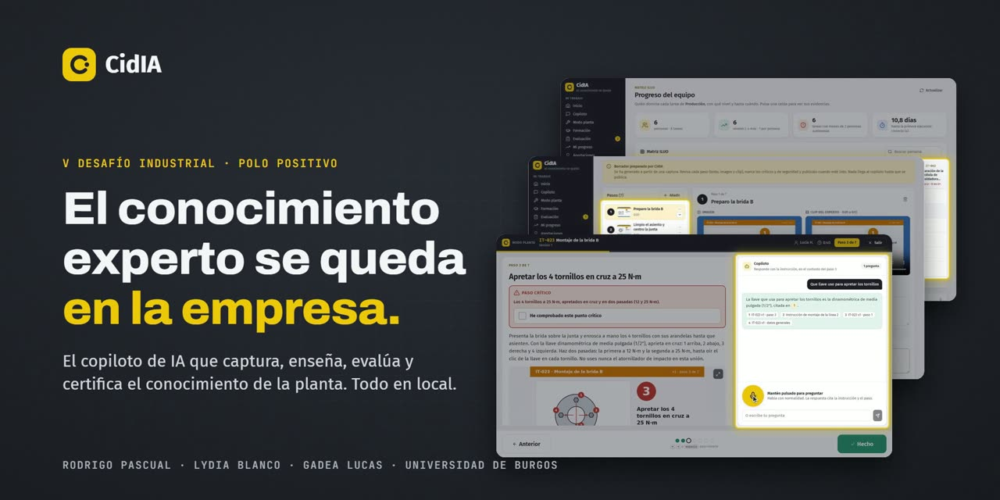
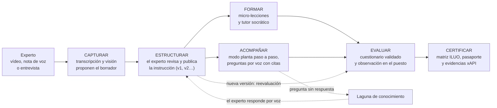

# CidIA

Copiloto de IA en local para capturar, estructurar, formar, acompañar, evaluar y certificar el conocimiento de una planta industrial. Candidatura al V DESAFÍO industrial de POLO positivo (Rodrigo Pascual, Lydia Blanco y Gadea Lucas, Universidad de Burgos).

El conocimiento experto se queda en la empresa: modelos, documentos, audios y vídeos viven en un servidor de la propia empresa, y cada persona encuentra solo lo que le corresponde por departamento, nivel y formación.

[](https://github.com/RodrigoPascual/cidia/releases/tag/v0.1.0)

## Cómo funciona



La IA propone y decide la persona: el experto valida los borradores, las preguntas del cuestionario y la foto final del puesto.

## Datos seguros

* **Nada sale de la empresa.** Modelos, documentos, audios, vídeos y evidencias viven en un servidor propio; la app de los portátiles solo habla con ese servidor y cualquier otra conexión se corta en el propio equipo.
* **Sin nube y sin pago por consulta.** Los modelos son abiertos y se ejecutan en local; los modelos en la nube están bloqueados por política. Si una empresa lo quisiera, el administrador puede habilitar modelos externos y CidIA se integra con otros sistemas por estándares abiertos (API compatible con OpenAI, MCP y xAPI para LMS y ERP).
* **Cada persona ve solo lo suyo.** Los permisos por departamento, nivel y formación se aplican en la base de datos antes de que el modelo lea nada, y todo queda en el registro de actividad.

## Cuánto cuesta y qué ahorra

Una instalación tipo (1 servidor con GPU y 5 puestos) ronda los **6.200 € en hardware**, sin licencias ni cuotas: todo el software es libre y de uso comercial ([`docs/presupuesto-hardware.md`](docs/presupuesto-hardware.md)). A cambio, el saber de los veteranos queda capturado y versionado, la formación de un recién llegado se apoya en el copiloto en lugar de en horas de un experto, y las auditorías encuentran las instrucciones actualizadas y quién está cualificado en cada tarea.

## Vídeo

<!-- AVANCE: aquí va el avance de 1 minuto (CidIA-avance.mp4), arrastrado desde el editor de GitHub -->

Los vídeos completos están en [Descargas](#descargas): el **resumen para el jurado** (5:08) y el **recorrido completo** (17:06), con las 25 funcionalidades probadas con ejemplos reales de una empresa ficticia (datos sintéticos, servidor de pruebas, voz sintética generada en local).

## Descargas

En la [versión 0.1.0](https://github.com/RodrigoPascual/cidia/releases/tag/v0.1.0) (sección *Releases* del repositorio):

| Fichero | Qué es |
|---|---|
| `CidIA-Setup.exe` | Instalador de la app para los portátiles de los trabajadores (Windows de 64 bits). |
| `CidIA-Setup.exe.sha256` | Huella para comprobar que el instalador no se ha alterado. |
| `CidIA-resumen.mp4` | Vídeo resumen para el jurado (5:08). |
| `CidIA-recorrido.mp4` | Recorrido completo por todas las funcionalidades (17:06). |
| `*.srt` | Subtítulos de los dos vídeos. |

## Cómo se instala

CidIA tiene dos partes: **un servidor** en la empresa, donde viven los modelos de IA, los documentos y los datos, y **la app** en los portátiles de cada trabajador, que se conecta a ese servidor. Nada sale a Internet.

**1. El servidor** (una vez por empresa). Un equipo con Ubuntu y una gráfica NVIDIA de 12 GB o más, por ejemplo el portátil MSI del proyecto. No hay `.exe`: el instalador es un script que está en este repositorio.

```bash
git clone https://github.com/RodrigoPascual/cidia.git
cd cidia/servidor/despliegue
bash instalar-servidor.sh --comprobar     # revisa el equipo sin cambiar nada
sudo bash instalar-servidor.sh            # instala Docker, los modelos y los servicios
```

Al terminar da la dirección del servidor (por ejemplo `http://servidor-cidia:18700`) y la contraseña de administración. Paso a paso, en [`docs/manual-servidor.md`](docs/manual-servidor.md).

**2. La app en cada portátil.** Se descarga `CidIA-Setup.exe` de [Descargas](#descargas) y se ejecuta:

* No pide permisos de administrador: se instala solo para ese usuario.
* Pregunta la dirección del servidor de la empresa, la que dio el paso 1.
* Crea el acceso directo **CidIA** en el escritorio y en el menú Inicio. Cada persona entra con su usuario y ve solo lo suyo.
* Aún no está firmado, así que la primera vez Windows puede mostrar «Windows protegió su PC». Se continúa con **Más información → Ejecutar de todas formas**.
* Para muchos equipos a la vez hay instalación sin ventanas: `CidIA-Setup.exe /S /SERVIDOR=http://servidor-cidia:18700`. Detalles en [`app/README.md`](app/README.md).

**3. Sin instalar nada**, desde cualquier navegador de la red de la empresa: `http://<servidor>:18700/app/`.

## Qué hay en el repositorio

```
app/                 lo que se instala en los portátiles (CidIA-Setup.exe)
  plugins/cidia/     plugin de la app de escritorio: paneles, sesión, marca y proxy al servidor
  perfil/            configuración bloqueada de la app (proveedor único, sin telemetría...)
  marca/             logos e iconos
  instalador/        construcción de CidIA-Setup.exe y del lanzador CidIA.exe
servidor/            lo que corre en el servidor de la empresa
  gateway/           servicio CidIA (FastAPI): API de la interfaz, API compatible con OpenAI y MCP
  web/               interfaz web (React), servida por el gateway en /app/
  asr/               servicio de transcripción de voz
  espacio-trabajo/   ejecutor de contenedores aislados para el agente
  weknora/           motor de conocimiento opcional
  despliegue/        docker compose, perfiles por equipo e instalador del servidor
datos-demo/          datos sintéticos de demostración
docs/                arquitectura, investigación y manuales
```

## Desarrollo

```bash
# gateway
cd servidor/gateway
python -m venv .venv && .venv/Scripts/python -m pip install -e ".[dev]"
CIDIA_TEST_BD=mio .venv/Scripts/python -m pytest -q        # necesita un PostgreSQL con pgvector (ver tests/conftest.py)

# interfaz
cd servidor/web
npm install && npm run dev                                  # proxy de /api al gateway (CIDIA_GATEWAY)
```

Arquitectura y contratos entre módulos: `docs/arquitectura.md` y `servidor/gateway/cidia/servicios/contratos.md`.

## Licencias

El código de CidIA es propiedad de sus autores. Los componentes de terceros y sus licencias están en `THIRD_PARTY_NOTICES.md`: solo se usan licencias permisivas (MIT, Apache-2.0, BSD, ISC, PostgreSQL) y FFmpeg LGPL como programa externo. Los vídeos se han hecho con herramientas libres en local (HyperFrames, Supertonic 3 y Kokoro-82M para las voces sintéticas); ver `herramientas/video/README.md`.
